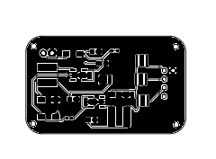
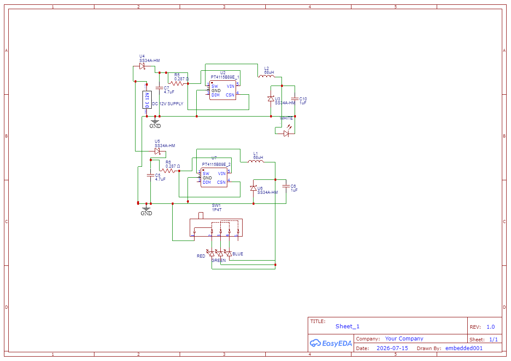

# Navigation & Strobe Light Board — PCB Design

## Project Overview

This project involves the design of a compact LED lighting PCB for navigation and landing light applications. The board integrates multiple LED colour channels and a separate white landing light circuit.

The project covers schematic design, PCB layout, component placement, and PCB manufacturing file generation using EasyEDA.

## PCB Design

### 3D PCB View — Front

### 3D PCB View — Back

### PCB Layout

### Circuit Schematic

## Circuit Schematic

## Features

- Red, green, and blue LED channels.
- Three-position switch for colour selection.
- Separate white landing light circuit.
- Independent power inputs for the colour and white LED circuits.
- Compact PCB layout.
- MCU-free hardware design without firmware requirements.

## Design Specifications

| Parameter | Specification |
|---|---|
| Project | Navigation & Strobe Light Board |
| Design software | EasyEDA |
| PCB layers | 2 |
| Copper weight | 1 oz |
| Recommended board dimensions | 45 mm × 14 mm |
| Colour channels | Red, Green, Blue |
| Landing light | White high-lumen LED |
| Colour selection | 3-position switch |

*Specifications are based on the design documentation and should be verified against the final PCB files.*

## Repository Contents

| File | Description |
|---|---|
| `3D View Front.png` | Front-side 3D PCB view |
| `3D view Back.png` | Back-side 3D PCB view |
| `PCB_PCB_Final_Strobe_Light.png` | PCB layout image |
| `Schematic_Final_Strobe_Light.png` | Circuit schematic |
| `PCB_Final_Strobe_Light_2.json` | EasyEDA PCB design file |
| `Gerber_Final_Strobe_Light...` | PCB manufacturing files, if this is the Gerber archive |

## Design Workflow

1. Develop the circuit schematic.
2. Select components and verify their electrical specifications.
3. Design the PCB layout in EasyEDA.
4. Verify footprints, routing, clearances, and connector pinouts.
5. Run design-rule checks.
6. Export manufacturing files for fabrication.

## Tools Used

- **EasyEDA** — Schematic capture and PCB layout.
- **Component datasheets** — Component selection and electrical verification.
- **Gerber files** — PCB fabrication, when available.

## Validation

The design files and PCB images document the current design. Hardware test results and electrical, thermal, and environmental validation should be documented separately when available.

## Disclaimer

This project documentation does not establish flight readiness or regulatory compliance. Appropriate testing and verification are required before use in an aircraft.

